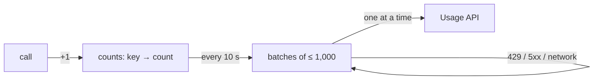

# Usage SDK specification

How every Update Prompt usage SDK behaves, whatever the language. Follow it and your SDK reports the same way as the official ones. The [Go SDK](https://github.com/Update-Prompt/usage-sdk-go) is the reference implementation.

**Keep the SDK simple.** It collects facts and sends them. Validation, normalisation, limits and every other rule live in Update Prompt. When in doubt, leave it out of the SDK.

## 1. Configuration

| Setting | Default |
|---|---|
| API key | `UPDATE_PROMPT_API_KEY`. Missing: the SDK does nothing and logs once; the application keeps running |
| Base URL | `https://usage.updateprompt.com`. `UPDATE_PROMPT_URL` overrides it, for tests |
| Consumer id | Set per request by the application, or a function. Unset means no consumer id |
| Route | From the framework, or a function |

The send interval and the memory limit are constants, not settings.

## 2. One call

| Field | Value |
|---|---|
| `method`, `host` | As received |
| `route` | The router's template, such as `/orders/{id}`, sent to `POST /v1/usage` |
| `path` | The raw path, only when there is no template, sent to `POST /v1/usage/paths`, followed by `?` and the query parameter names (escaped, no values) when there are any |
| `consumer` | As set by the application, or left out |
| `queryParams` | Names from the query string, decoded. Collected per report (each name once, in the order seen, at most 50, names over 512 bytes skipped), so they never split a report. Path reports carry them as the query string instead |
| `timestamp` | When the request started, rounded down to the minute, UTC |

The one rule in the SDK: a call with **no template that answered 404** isn't counted, so scanners don't create endpoints. Only the SDK knows the status.

## 3. Counting and sending

| Rule | Value |
|---|---|
| Key | Method, host, route or path, consumer and minute. A call whose key is over 8 KB is dropped, so junk requests can't fill memory |
| Send | Every 10 s ±20% jitter: take the counts, start new ones, and split them into batches of at most 1,000 reports and under 1 MB, one endpoint per batch |
| In flight | One request at a time, oldest batch first |
| Memory limit | 10,000 distinct reports, counting and waiting together. When full, calls that need a new report are dropped; existing ones keep counting |
| Idempotency-Key | 128 random bits, base64url, per batch, kept on every retry |
| Timeout | 10 s per request |
| Shutdown | `close` sends what's left until the application's deadline, then drops the rest |
| Serverless | `flush` at the end of an invocation |

## 4. Answers

| Answer | The SDK |
|---|---|
| 2xx (202, 207) | Done, without reading the body |
| 429, 5xx, network error | Retries the same batch after `Retry-After` (seconds or a date, at most 5 minutes), else after a backoff from 1 s doubling to 60 s, ±20%. A request the SDK cancels itself, such as on shutdown, isn't a failure and is retried at once |
| Any other 4xx | Drops the batch and logs once |

The API decides everything else: invalid reports (207), reports over 24 hours old (refused, so retries end), revoked keys (401) and limits (429).

## 5. Requests

Every request to the Usage API carries:

| Header | Value |
|---|---|
| `Authorization` | `Bearer <API key>` |
| `Content-Type` | `application/json` |
| `Idempotency-Key` | The batch's key (§3) |
| `User-Agent` | `<sdk name>/<version> (<runtime>/<version>)`, such as `usage-sdk-go/0.1.0 (go1.27.3)` |

The body is `{"reports": [ ... ]}` with the fields of §2 plus `count`. The [Usage API reference](https://updateprompt.com) has the full schema and every answer.

## 6. Stats and logs

`stats` returns the calls `counted`, `sent` and `dropped`. Logs are off unless the application passes a logger, with at most one line per problem an hour.

## 7. Deprecation signals

Coming. SDKs will read `GET /v1/deprecation-signals` once a minute and add its headers and refusals to responses. This section will say exactly how, with test cases.

Already decided: **signals apply only to calls the router matched to a route.** So every SDK answers the same, whatever its router:

| Call | Signals |
|---|---|
| Matched a route, whatever it answers, such as a 404 for a missing order | Applied: headers, and the refusal when there is one |
| Matched no route, so the router answered 404 or 405 itself | None: the router's answer is sent as it is |
| No router to ask, such as a plain handler | Applied: every call counts as matched |

A path the API doesn't have isn't a deprecated endpoint, and some routers run middleware only for matched routes, so this is the one rule every SDK can follow.

## 8. Conformance

Every SDK tests, against a fake Usage API:

| Area | Cases |
|---|---|
| Call to report | Method, host, route or path, the 404 rule, query parameter names, minute rounding |
| Counting | Same key adds up, a new minute splits, the memory limit keeps existing reports and drops new ones, keys over 8 KB are dropped |
| Sending | Batches split at 1,000 reports and 1 MB, the same Idempotency-Key on every retry, `Retry-After` in seconds and as a date, capped at 5 minutes |
| Answers | 2xx done, 429 / 5xx / network retried, other 4xx dropped |
| Shutdown | `close` sends what's left, then drops the rest at its deadline |
| Deprecation signals | Coming. Already: a matched route gets them, also when it answers 404; the router's own 404 and 405 for unmatched calls get none |

Shared test cases that any SDK can run are planned for this repository.
